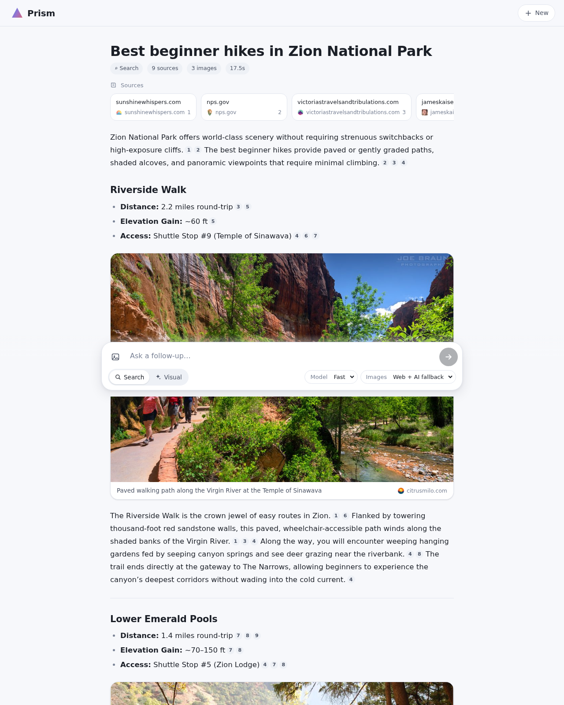
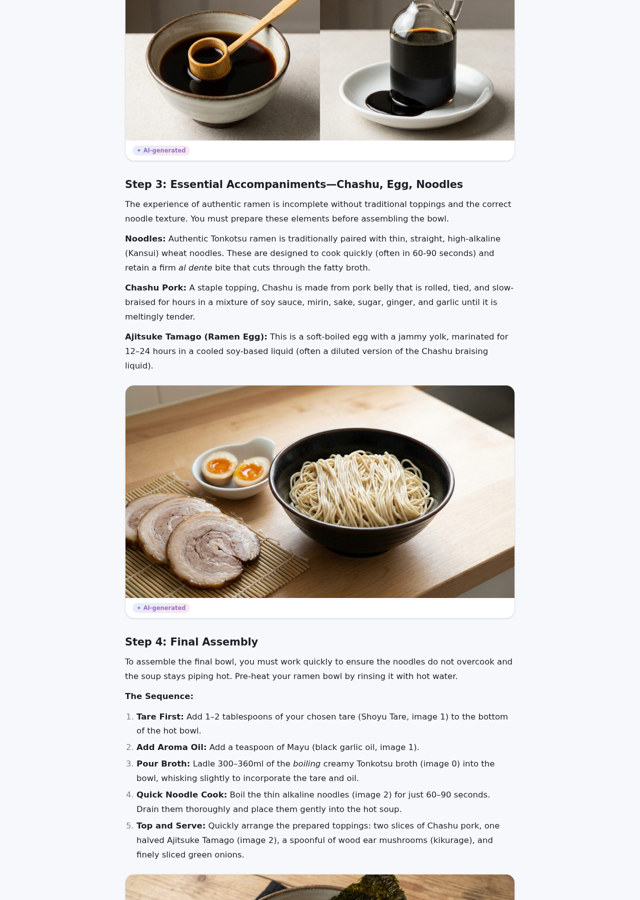
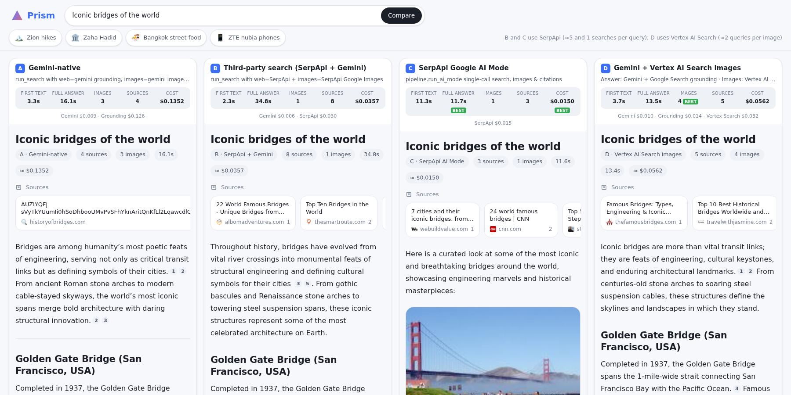

# Prism — Multimodal AI Search

Prism is a search website. You ask a question in plain language and get back an
answer where **text and images are interleaved**, like a magazine article. It
runs entirely on **Gemini on Vertex AI** and
needs no third-party API keys by default.


**Demo recordings:** [demo/](demo/) ·
**Design docs:** [architecture](docs/architecture.md),
[design decisions](docs/design-decisions.md),
[image search grounding](docs/image-search-grounding.md),
[Gemini vs SerpApi comparison](docs/third-party-comparison.md)

<table>
<tr>
<td></td>
<td></td>
</tr>
<tr>
<td align="center">Search mode: grounded answer with verified real web photos</td>
<td align="center">Visual mode: Gemini's native interleaved text and images</td>
</tr>
</table>

## Three architectures

Prism supports three distinct search architectures, evaluated across 8 diverse visual queries:

| Architecture | First text (p50) | Full answer (p50) | Images / query | Relevance | Infrastructure & Cost |
|---|---|---|---|---|---|
| **A. Gemini-native (default)** | 4.8 s | **20.5 s** | **2.9** | **19/23 (83%)** | 1 Vertex AI project, 0 external keys |
| **B. Third-party search** | **4.3 s** | 33.2 s | 2.4 | 16/19 (84%) | Vertex AI + SerpApi (~5 searches/query) |
| **C. SerpApi Google AI Mode** | 8.5 s (no stream) | **8.5 s** | 0.1 | 1/1 | 1 SerpApi search/query, 0 Gemini |

*   **Architecture A (Gemini-native):** Answers stream from `gemini-3.8-flash` using Grounding with Google Search. Image slots resolve concurrently using `gemini-3.1-flash-image` image search grounding and `gemini-3.1-flash-lite` visual re-ranking.
*   **Architecture B (Third-party search):** SerpApi fetches Google web search results passed to `gemini-3.8-flash` as context. Image slots are retrieved via SerpApi Google Images and pass through the same Pillow normalization and visual re-ranking pipeline.
*   **Architecture C (SerpApi Google AI Mode):** A single call to SerpApi `engine=google_ai_mode`. Parsed into text blocks and citations by `app/aimode.py`. Non-streaming; answers are ~3× shorter and rarely include images (1 image across 8 test queries, which failed to download).

**Recommendation:** **Architecture A (Gemini-native)** is the recommended default: it delivers the fastest full answer (20.5 s vs 33.2 s), the highest image yield (2.9 vs 0.1), equal relevance (83%), and requires only a single Google Cloud project without third-party API keys. See the [full benchmark](docs/third-party-comparison.md).

## Compare portal

Prism includes an interactive comparison portal at `/compare` to evaluate all three architectures side-by-side on identical queries.



*Example: "Famous lighthouses of Scotland". A finished in 19.6 s with 4 images, B in 31.5 s with 3 images, C in 6.1 s with no images. A SerpApi result that comes back in under 1.5 s is served from its 1-hour cache, so it's labeled "cached" and excluded from the "best" badge.*

*   **Live Metrics:** Measures client-side time-to-first-token (TTFT), total completion time, source count, and filled image figures using sandboxed `<iframe>` panels running in embed mode (`/?embed=1&arch=...`).
*   **Decoupled & Isolated:** Panels communicate metrics back to the portal via `window.parent.postMessage({type: "prism-metrics", ...})`, preventing state collisions between concurrent streams.
*   **Requirements:** Architecture A runs with Vertex AI alone. Architectures B and C require setting `SERPAPI_API_KEY` in the environment; otherwise their columns show a disabled placeholder card.

## Quick start (local)

Prerequisites: Python 3.12+, a Google Cloud project with the Vertex AI API enabled, and Application Default Credentials (`gcloud auth application-default login`).

```bash
python3 -m venv ~/venvs/prism && source ~/venvs/prism/bin/activate
pip install -r requirements.txt
export GOOGLE_CLOUD_PROJECT=<your-project>
uvicorn app.main:app --port 8080 --reload --reload-dir app
# open http://localhost:8080 or http://localhost:8080/compare
```

Run from the terminal:

```bash
python -m scripts.cli_search "best beginner hikes in Zion"
python -m scripts.cli_search "how does a jet engine work" --mode visual
```

Run unit tests (no network or credentials needed):

```bash
python -m unittest discover -s tests -t .
```

## Configuration

All configuration is managed through environment variables in `app/config.py`:

Env var | Default | Meaning
---|---|---
`GOOGLE_CLOUD_PROJECT` | ADC project | Vertex AI project ID
`GOOGLE_CLOUD_LOCATION` | `global` | Vertex AI location
`ANSWER_MODEL` | `gemini-3.8-flash` | "Fast" text answer model
`PRO_MODEL` | `gemini-3.1-pro-preview` | "Pro" text answer model
`FALLBACK_MODEL` | `gemini-2.5-flash` | Used if the answer model fails before streaming
`IMAGE_MODEL` | `gemini-3.1-flash-image` | Image search grounding, generation, and Visual mode
`LITE_MODEL` | `gemini-3.1-flash-lite` | Visual re-ranking and related questions
`RERANK_IMAGES` | `true` | Visually verify web images using `LITE_MODEL`
`ALLOW_IMAGE_GENERATION` | `false` | Cost control: `false` = only real web/Wikimedia photos, never generated images (Visual mode and AI image options are hidden)
`IMAGE_SEARCH_MAX_TOKENS` | `128` | Output cap for the image-search call (a Gemini image needs >1,000 tokens, so generation is impossible)
`IMAGE_PROVIDER` | `gemini` | Image search: `gemini` (Google image-search grounding), `serpapi` (Google Images via SerpApi), `brave`, `openverse` (keyless, CC only)
`WEB_PROVIDER` | `gemini` | Answer grounding: `gemini` (Grounding with Google Search) or `serpapi` (Google web results passed to Gemini as context)
`SERPAPI_API_KEY` | `""` | API key for SerpApi (enables Architecture B and C)
`BRAVE_API_KEY` | `""` | API key for Brave search provider
`SERPAPI_NO_CACHE` | `""` | Set to `1` to bypass SerpApi cache for fresh latency benchmarks
`ENABLE_WIKIMEDIA` | `true` | Wikimedia Commons fallback when search yields no suitable image
`MAX_IMAGE_SLOTS` | `6` | Maximum image slots per answer
`IMAGE_CONCURRENCY` | `6` | Maximum parallel slot resolution tasks
`RATE_LIMIT_PER_MIN` | `20` | Per-IP searches per minute (0 = off)

## Deploy to Cloud Run (protected by IAP)

Deploy the container to Cloud Run with Identity-Aware Proxy (IAP) for access control:

```bash
PROJECT=<your-project>
SA=prism-search@$PROJECT.iam.gserviceaccount.com
gcloud iam service-accounts create prism-search --project $PROJECT
gcloud projects add-iam-policy-binding $PROJECT --member serviceAccount:$SA \
  --role roles/aiplatform.user --condition=None

gcloud run deploy prism-search --source . --project $PROJECT --region us-central1 \
  --service-account $SA --set-env-vars GOOGLE_CLOUD_PROJECT=$PROJECT \
  --memory 1Gi --cpu 2 --concurrency 20 --timeout 300 --max-instances 5 \
  --iap --no-allow-unauthenticated
```

To supply `SERPAPI_API_KEY` securely from Secret Manager, append `--set-secrets`:

```bash
gcloud run deploy prism-search --source . --project $PROJECT --region us-central1 \
  --service-account $SA --set-env-vars GOOGLE_CLOUD_PROJECT=$PROJECT \
  --set-secrets SERPAPI_API_KEY=serpapi-key:latest \
  --memory 1Gi --cpu 2 --concurrency 20 --timeout 300 --max-instances 5 \
  --iap --no-allow-unauthenticated
```

Authorize IAP and grant users access:

```bash
PN=$(gcloud projects describe $PROJECT --format='value(projectNumber)')
gcloud run services add-iam-policy-binding prism-search --region us-central1 --project $PROJECT \
  --member serviceAccount:service-$PN@gcp-sa-iap.iam.gserviceaccount.com --role roles/run.invoker
# Let everyone in your organization(s) sign in; no per-user allow-list needed.
# (Use --member=user:<email> or group:<email> to restrict further.)
gcloud iap web add-iam-policy-binding --resource-type=cloud-run --service=prism-search \
  --region=us-central1 --project $PROJECT --member=domain:<your-domain.com> \
  --role=roles/iap.httpsResourceAccessor --condition=None
```

Anyone with an account in the granted domain(s) can open the app after a Google
sign-in. Fully public access (`allUsers`) is deliberately not recommended: every
query spends Gemini and SerpApi quota.

> [!NOTE]
> Cloud Run reserves URL paths that end in `z` (such as `/healthz`), so the
> health check endpoint is `/health`.

## Project layout

Path | Purpose
---|---
`app/main.py` | FastAPI app, SSE endpoint, `/compare` route, rate limiting, static files
`app/pipeline.py` | Search and Visual orchestration, prompts, grounding → sources/citations
`app/images.py` | Image search, download/validation, visual re-rank, Wikimedia, generation
`app/providers.py` | Pluggable search providers (SerpApi, Brave, Openverse)
`app/aimode.py` | SerpApi Google AI Mode response parser and markdown generator
`app/textproc.py` | Streaming `[[IMAGE: …]]` slot parser, citation insertion (pure, tested)
`app/genai_client.py` | Vertex AI Gemini client
`app/config.py` | Runtime configuration (all overridable by environment variables)
`app/static/` | Front end (`index.html`, `app.js`, `styles.css`, `compare.html`, `compare.js`, vendored marked + DOMPurify)
`tests/` | Unit and API tests (Gemini and network are mocked)
`scripts/cli_search.py` | Run a live search from the terminal
`scripts/record_demo.py` | Record scripted demo videos with headless Chrome + ffmpeg
`docs/` | Technical documentation and benchmarks ([index](docs/README.md))
`demo/` | Screen recordings ([index](demo/README.md))

## Documentation

*   [Documentation Index](docs/README.md): Overview of all project documentation.
*   [Architecture](docs/architecture.md): Deep dive into the streaming lifecycle, slot protocol, three architectures, and compare portal.
*   [Design Decisions](docs/design-decisions.md): Architecture Decision Records (ADRs) explaining key design trade-offs.
*   [Image Search Grounding](docs/image-search-grounding.md): How Prism uses Gemini image models for web photo search without generation.
*   [Third-Party Search Comparison](docs/third-party-comparison.md): Empirical benchmark comparing Gemini-native, SerpApi, and Google AI Mode.
