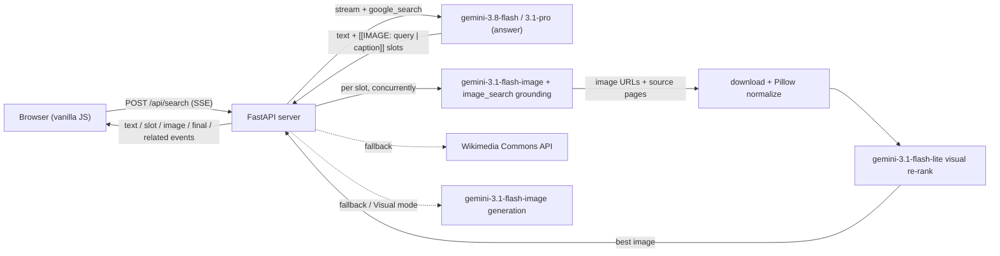

# Prism — Multimodal AI Search

Prism is a search website. You ask a question in plain language and get back an
answer where **text and images are interleaved**, like a magazine article. It
runs entirely on **Gemini on Gemini Enterprise Agent Platform (Vertex AI)** and
needs no third-party API keys.


**Demo recordings:** [demo/](demo/) ·
**Design docs:** [architecture](docs/architecture.md),
[design decisions](docs/design-decisions.md)

<table>
<tr>
<td></td>
<td></td>
</tr>
<tr>
<td align="center">Search mode: grounded answer with verified real web photos</td>
<td align="center">Visual mode: Gemini's native interleaved text and images</td>
</tr>
</table>

## Features

*   **Natural-language search** grounded in **Google Search**, with inline
    numbered citations, source cards and Google Search suggestions.
*   **Interleaved real images (Search mode).** While the answer streams, Gemini
    places image slots where a picture helps. Each slot is filled with a
    **real photo from the web** found through Gemini's *Google image search*
    grounding. A small Gemini model **looks at the candidate pixels** and picks
    the best match, rejecting logos, text and off-topic images. If no web image
    fits, Prism falls back to Wikimedia Commons, then (optionally) to a
    Gemini-generated illustration labeled *AI-generated*.
*   **Real images only by default.** Image generation is off
    (`ALLOW_IMAGE_GENERATION=false`) to minimize cost: every picture is a real
    photo from the web, linked to its source. Set it to `true` to enable the
    AI fallback and Visual mode.
*   **Visual mode (optional, needs `ALLOW_IMAGE_GENERATION=true`).** Gemini's **native interleaved text + image output**
    (`gemini-3.1-flash-image`, also grounded with Google Search) writes the
    answer and generates illustrations inline in a single streamed call.
*   **Multimodal input.** Attach, paste or drag in an image ("what is this
    building?").
*   **Conversational follow-ups**, related-search suggestions, Fast/Pro model
    switch, image source preference (web + AI fallback / web only / AI only),
    shareable `?q=` URLs, lightbox, dark mode and a responsive layout.

## Architecture



The server streams **Server-Sent Events**:

Event          | Payload
-------------- | ---------------------------------------------------------------
`status`       | `{stage, message}` progress updates
`text`         | `{delta}` streamed Markdown
`slot`         | `{id, query, caption}` image placeholder at the current position
`image`        | `{id, src (data URL), kind: web/wikimedia/generated, source_url, domain, title, license, width, height}`
`image_failed` | `{id}` slot could not be filled (removed from the page)
`final`        | `{markdown (with @@CITE@@ / @@SLOT@@ tokens), sources, search_entry_point, queries, model}`
`related`      | `{questions}` follow-up suggestions
`error`        | `{message}`
`done`         | `{elapsed_ms}`

Code layout:

Path                    | Purpose
----------------------- | ------------------------------------------------------
`app/main.py`           | FastAPI app, SSE endpoint, rate limiting, static files
`app/pipeline.py`       | Search and Visual orchestration, prompts, grounding → sources/citations
`app/images.py`         | Image search, download/validation, visual re-rank, Wikimedia, generation
`app/textproc.py`       | Streaming `[[IMAGE: …]]` slot parser, citation insertion (pure, tested)
`app/genai_client.py`   | Vertex AI Gemini client
`app/config.py`         | Settings (all overridable by environment variables)
`app/static/`           | Front end (`index.html`, `app.js`, `styles.css`, vendored marked + DOMPurify)
`tests/`                | Unit and API tests (Gemini and network are mocked)
`scripts/cli_search.py` | Run a live search from the terminal
`scripts/record_demo.py`| Record scripted demo videos with headless Chrome + ffmpeg
`docs/`                 | [Architecture](docs/architecture.md), [design decisions](docs/design-decisions.md), screenshots
`demo/`                 | Screen recordings ([index](demo/README.md))

## Run locally

Prerequisites: Python 3.12+, a GCP project with the Vertex AI API enabled, and
Application Default Credentials (`gcloud auth application-default login`).

```bash
python3 -m venv ~/venvs/prism && source ~/venvs/prism/bin/activate
pip install -r requirements.txt
export GOOGLE_CLOUD_PROJECT=<your-project>
uvicorn app.main:app --port 8080 --reload --reload-dir app
# open http://localhost:8080
```

From the terminal:

```bash
python -m scripts.cli_search "best beginner hikes in Zion"            # Search mode
python -m scripts.cli_search "how does a jet engine work" --mode visual
```

Tests (no network needed):

```bash
python -m unittest discover -s tests -t .
```

## Deploy to Cloud Run (protected by IAP)

```bash
PROJECT=<your-project>
SA=prism-search@$PROJECT.iam.gserviceaccount.com
gcloud iam service-accounts create prism-search --project $PROJECT
gcloud projects add-iam-policy-binding $PROJECT --member serviceAccount:$SA \
  --role roles/aiplatform.user --condition=None

gcloud run deploy prism-search --source . --project $PROJECT --region us-central1 \
  --service-account $SA --set-env-vars GOOGLE_CLOUD_PROJECT=$PROJECT \
  --memory 1Gi --cpu 2 --concurrency 20 --timeout 300 --max-instances 5 \
  --iap --no-allow-unauthenticated

# Let IAP invoke the service, then allow specific users to sign in.
PN=$(gcloud projects describe $PROJECT --format='value(projectNumber)')
gcloud run services add-iam-policy-binding prism-search --region us-central1 --project $PROJECT \
  --member serviceAccount:service-$PN@gcp-sa-iap.iam.gserviceaccount.com --role roles/run.invoker
gcloud iap web add-iam-policy-binding --resource-type=cloud-run --service=prism-search \
  --region=us-central1 --project $PROJECT --member=user:<you@example.com> \
  --role=roles/iap.httpsResourceAccessor --condition=None
```

Users open the `run.app` URL in a browser and sign in with Google. If you
don't use IAP, drop `--iap` and use
`gcloud run services proxy prism-search --region us-central1 --port 8081`.

> [!NOTE]
> Cloud Run reserves URL paths that end in `z` (such as `/healthz`), so the
> health check is `/health`.

## Configuration

Env var                     | Default                   | Meaning
--------------------------- | ------------------------- | -------
`GOOGLE_CLOUD_PROJECT`      | ADC project               | Vertex AI project
`GOOGLE_CLOUD_LOCATION`     | `global`                  | Vertex AI location
`ANSWER_MODEL`              | `gemini-3.8-flash`        | "Fast" answer model
`PRO_MODEL`                 | `gemini-3.1-pro-preview`  | "Pro" answer model
`FALLBACK_MODEL`            | `gemini-2.5-flash`        | Used if the answer model fails before streaming
`IMAGE_MODEL`               | `gemini-3.1-flash-image`  | Image search grounding, generation, Visual mode
`LITE_MODEL`                | `gemini-3.1-flash-lite`   | Visual re-ranking, related questions
`RERANK_IMAGES`             | `true`                    | Visually verify web images
`ALLOW_IMAGE_GENERATION`    | `false`                   | Cost control: `false` = only real web/Wikimedia photos, never generated images (Visual mode and AI image options are hidden)
`IMAGE_SEARCH_MAX_TOKENS`   | `128`                     | Output cap for the image-search call (a Gemini image needs >1,000 tokens, so generation is impossible)
`IMAGE_PROVIDER`            | `gemini`                  | Image search: `gemini` (Google image-search grounding), `serpapi` (Google Images via SerpApi), `brave`, `openverse` (keyless, CC only)
`WEB_PROVIDER`              | `gemini`                  | Answer grounding: `gemini` (Grounding with Google Search) or `serpapi` (Google web results passed to Gemini as context)
`SERPAPI_API_KEY` / `BRAVE_API_KEY` | —                | Keys for the third-party providers (set as env vars / Secret Manager, never commit)
`ENABLE_WIKIMEDIA`          | `true`                    | Wikimedia Commons fallback
`MAX_IMAGE_SLOTS`           | `6`                       | Max images per answer
`IMAGE_CONCURRENCY`         | `6`                       | Parallel slot resolutions per request
`RATE_LIMIT_PER_MIN`        | `20`                      | Per-IP searches/minute (0 = off)

## Why Gemini only (no third-party APIs)

*   **Text answers + citations:** Gemini with *Grounding with Google Search*.
*   **Real web images:** `google_search` with `search_types.image_search` is
    available on the Gemini image models. It returns image grounding chunks
    (`image_uri`, `source_uri`, `title`, `domain`) that Prism downloads and
    verifies. Text models such as `gemini-3.8-flash` reject `image_search`.
    That is why the image model is used as an image-search engine.
*   **Generated images:** native interleaved output via
    `response_modalities=["TEXT", "IMAGE"]`.

If you want more image sources, add another candidate provider in
`app/images.py` (e.g. Google Programmable Search JSON API, Unsplash, Pexels).
Each provider returns `Candidate` objects and gets the same download, re-rank
and dedupe treatment.

## Notes and limits

*   Images are proxied as normalized JPEG data URLs (≤1024px), so the browser
    never hotlinks third-party hosts, and every image links to its source page.
    Web images are subject to their owners' copyright.
*   Google Search grounding terms require displaying the Search Suggestions
    (`search_entry_point`); Prism renders them under each answer.
*   The in-process rate limiter is per instance. Put Cloud Armor or IAP in front
    for a public deployment.
