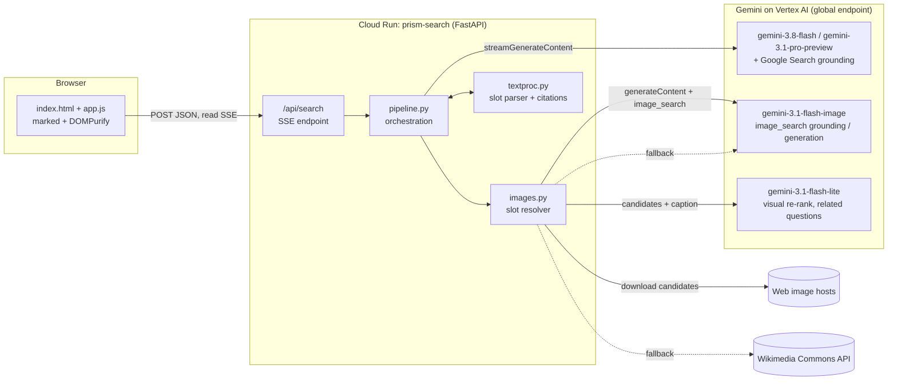
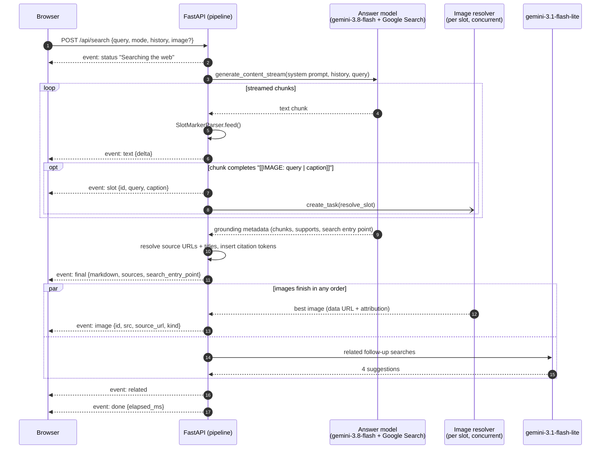
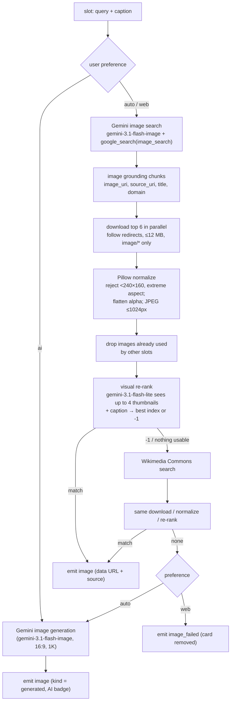
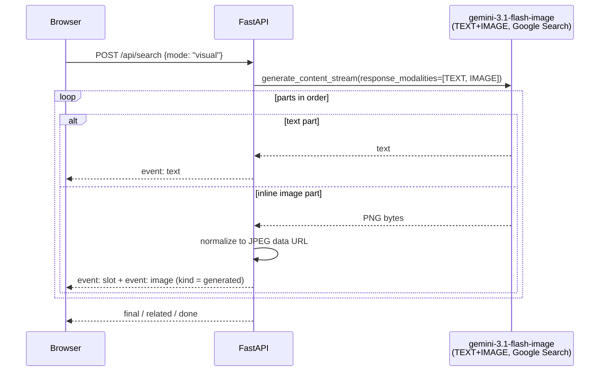
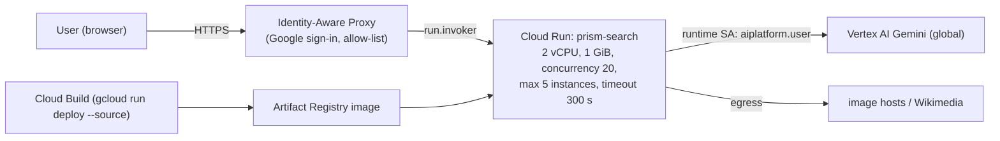

# Prism architecture

This document explains how Prism turns a natural-language question into an
answer where text and images are interleaved.

*   [System overview](#system-overview)
*   [Components](#components)
*   [Request lifecycle](#request-lifecycle)
*   [Image slot resolution](#image-slot-resolution)
*   [Visual mode](#visual-mode)
*   [Streaming protocol (SSE)](#streaming-protocol-sse)
*   [Front-end rendering model](#front-end-rendering-model)
*   [Deployment](#deployment)
*   [Security and safety](#security-and-safety)
*   [Performance](#performance)

## System overview



Everything that needs intelligence runs on Gemini: understanding the question,
web research, writing, picking images, judging them visually, and generating
images. The server is a thin, fully async orchestrator.

## Components

Module                | Responsibility
--------------------- | --------------------------------------------------------
`app/main.py`         | FastAPI app, static files, `/api/search` SSE endpoint, request validation, per-IP rate limit, keep-alives, cancellation when the client disconnects
`app/pipeline.py`     | The two modes (`run_search`, `run_visual`), prompts, model fallback, grounding metadata → sources, citations, search suggestions, related questions
`app/images.py`       | Candidate retrieval (Gemini image search, Wikimedia), download and validation, Pillow normalization, visual re-ranking, generation, cross-slot dedupe
`app/textproc.py`     | Pure functions: incremental `[[IMAGE: …]]` parser, citation insertion, title cleanup
`app/genai_client.py` | Single shared `google-genai` client (`vertexai=True`, retries)
`app/config.py`       | All tunables via environment variables
`app/static/`         | Dependency-free front end (vendored `marked` and `DOMPurify`)

## Request lifecycle



Key points:

1.  **Text is never blocked on images.** Slots are placeholders. The browser
    shows a shimmer card in the right place right away, and the image fills in
    when it's ready.
2.  **Image work starts mid-stream.** A slot task starts the moment its marker
    is parsed. By the time the text finishes, most images are nearly done.
3.  **Model fallback.** If the primary answer model fails before any text is
    emitted, the request retries on `FALLBACK_MODEL`.
4.  **Citations come at the end.** Grounding supports arrive with the final
    chunk. The server locates each supported segment in the assembled Markdown
    and inserts `@@CITE:n@@` tokens. The browser re-renders once with citation
    chips.
5.  **Conversation.** The browser sends previous turns as plain text (slot and
    citation tokens removed), so follow-ups like "which of these…" work.

### The slot protocol

The answer model is instructed to write image slots on their own line:

```text
[[IMAGE: Angels Landing chains section Zion | Hikers using the chains on the final ridge]]
```

*   The **query** is a self-contained, visual image-search query (proper nouns,
    place, model, year).
*   The **caption** is what the image should show. It drives visual re-ranking
    and becomes the figure caption.

`SlotMarkerParser` handles markers split across arbitrary stream chunks. It
streams ordinary text immediately and holds back only a possible marker prefix
(`[`, `[[`, `[[IMA…`). Malformed or unclosed markers fall back to plain text.
See `tests/test_textproc.py`.

## Image slot resolution



### Why Gemini's image model does the image search

Gemini's `google_search` tool takes `search_types` with `web_search` and
`image_search`. In testing against the Vertex AI API:

*   Text models (for example `gemini-3.8-flash`) reject `image_search` with
    `400 image_search is not supported for this model`.
*   `gemini-3.1-flash-image` accepts it and returns `grounding_chunks[].image`
    entries with `image_uri` (a redirect to the original image),
    `source_uri` (the page), `title` and `domain`.
*   That model must use `response_modalities=["TEXT","IMAGE"]` (TEXT-only is
    rejected), so the prompt asks for a text-only reply.
*   Asking *"What does X look like? Look it up with Google image search…"*
    triggers the search reliably. Bare "find images of X" sometimes gets an
    answer from memory with no search, so the resolver retries once with a
    different phrasing.
*   The model's internal names for retrieved images (`image_0`, `image_1`, …)
    **don't map reliably** onto the returned chunk order. So instead of letting
    one call both write the answer and place retrieved images, Prism runs one
    targeted search per slot and verifies the candidates visually.

### Visual re-ranking

Candidate images are downscaled to 384 px and sent to `gemini-3.1-flash-lite`,
together with the slot query and caption, as one multimodal request. The
response is constrained to a JSON schema (`{"best": int, "reason": str}`).
The model rejects images that are mostly text or logos, screenshots,
collages, watermarked stock previews or a different subject. A `-1` moves the
slot to the next source. If the re-rank call itself fails, the first candidate
is used.

### Cross-slot dedupe

All slots of one answer share a `set` of final image URLs. A candidate already
used by another slot is filtered out before ranking. The chosen URL is claimed
with no `await` between the check and the claim, which makes the claim atomic
under asyncio.

## Visual mode



Here Gemini produces the interleaving natively: it decides where each picture
goes and generates it, so text and images arrive in their final order.

## Streaming protocol (SSE)

`POST /api/search` with a JSON body:

```json
{
  "query": "best beginner hikes in Zion",
  "mode": "search",            // or "visual"
  "model": "fast",             // or "pro"
  "images": "auto",            // "auto" | "web" | "ai"
  "history": [{"role": "user", "text": "..."}, {"role": "model", "text": "..."}],
  "image": "data:image/jpeg;base64,..."   // optional query image
}
```

The response is `text/event-stream`. A `: keep-alive` comment is sent every
15 s.

Event          | Data
-------------- | ----
`status`       | `{stage: "search" \| "images" \| "retry", message}`
`text`         | `{delta}`
`slot`         | `{id, query, caption}`
`image`        | `{id, src, kind: "web" \| "wikimedia" \| "generated", width, height, source_url, title, domain, license, caption}`
`image_failed` | `{id}`
`final`        | `{markdown, sources: [{n, title, url, domain}], search_entry_point, queries, model}`
`related`      | `{questions: [..]}`
`error`        | `{message}`
`done`         | `{elapsed_ms}`

Tokens inside `markdown`:

*   `@@SLOT:<id>@@` marks where image slot `<id>` sits.
*   `@@CITE:1,3@@` marks citations to sources 1 and 3.

## Front-end rendering model

The front end is plain JavaScript with no build step:

1.  Each turn keeps a Markdown string and a `Map` of slot ID → `<figure>`
    element.
2.  On every `text` or `slot` event, a `requestAnimationFrame`-throttled
    `render()` runs:
    *   Replace `@@SLOT@@` with `<div data-slot>` and `@@CITE@@` with
        `<span data-cite>`.
    *   Run `marked` and then `DOMPurify`.
    *   Swap each placeholder for the **persistent** figure element. Loaded
        images never flicker, because the same DOM node is re-attached.
3.  An `image` event fills the figure (blurred backdrop, caption, source
    favicon and link, license, or an "AI-generated" badge). `image_failed`
    hides the figure.
4.  `final` replaces the Markdown with the cited version, renders source cards
    and shows Google Search Suggestions in a Shadow DOM, as the grounding terms
    require.
5.  The composer moves from the hero to a bottom dock for follow-ups. A busy
    request can be stopped (`AbortController`). `?q=` URLs are shareable.

## Deployment



*   The container is `python:3.13-slim` running uvicorn as a non-root user. The
    app is stateless, so it scales horizontally.
*   Auth uses the runtime service account through Application Default
    Credentials. There are no API keys in the code or configuration.

## Security and safety

*   **No secrets.** Vertex AI access comes from ADC or the Cloud Run service
    account.
*   **Access control.** Deploy behind IAP or `--no-allow-unauthenticated`.
    There is also a per-instance, per-IP rate limit (`RATE_LIMIT_PER_MIN`).
*   **No SSRF from user input.** The server only fetches URLs that come from
    Gemini grounding metadata or the Wikimedia API, never URLs typed by the
    user. Downloads are capped (12 MB, timeouts), restricted to `image/*`, and
    exclude SVG.
*   **Decompression bombs.** `Image.MAX_IMAGE_PIXELS` is capped, and images are
    always re-encoded.
*   **XSS.** All model output passes through `DOMPurify`. Links get
    `rel=noopener`. Images are delivered as same-origin data URLs, so the
    browser never hotlinks third-party hosts.
*   **Attribution and transparency.** Every web image links to its source page.
    Wikimedia images show license and author. Generated images carry an
    "AI-generated" badge.
*   **Uploads.** Query images must be data URLs of 7 MB or less. They are
    decoded and re-encoded server-side before reaching the model.

## Performance

Typical timings measured during development (local server and Cloud Run):

Stage                                  | Time
-------------------------------------- | -----------------
First answer token (Search, Fast)      | ~4–6 s
Full answer text                       | ~10–17 s
One image slot (search + rank)         | ~5–9 s after the slot appears
Whole Search answer with 3–5 images    | ~17–25 s
Visual mode with 2–4 generated images  | ~25–50 s

Levers: `RERANK_IMAGES=false` (about 1–2 s less per slot), `IMAGE_CONCURRENCY`,
`MAX_IMAGE_SLOTS`, and Fast vs. Pro model choice.
