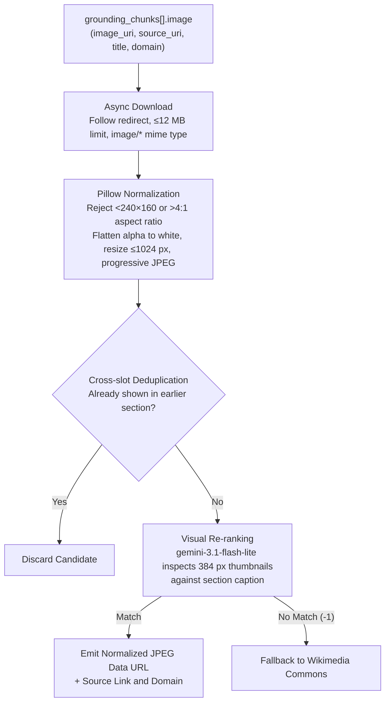

# Image Search Grounding in Gemini

How Prism retrieves real web images from Gemini without ever generating an image (about 60 output tokens per search call).

## Overview

Prism serves visual search answers with real, verified photos from the web placed alongside relevant text sections. Rather than relying on separate third-party image search APIs by default, Prism uses Gemini's native **Google image search grounding** tool.

However, Google image search grounding in the Gemini API has unique characteristics:
1. **Text models cannot run image search.** Any attempt to pass `image_search` to text models results in an API error.
2. **Image models require multimodal output configuration.** Calls to image models must specify `response_modalities=["TEXT", "IMAGE"]`.
3. **Generated images are expensive.** Generating an image consumes over 1,000 output tokens.

Prism solves this by using Gemini image models as pure search engines: we query the model with an image-search prompt, constrain the output with a **128-token cap**, and harvest only the retrieved web image metadata from the grounding chunks.

---

## 1. Why the Image Model is Needed

When calling Gemini with Grounding with Google Search, `google_search` supports two search types: `web_search` and `image_search`.

Text models accept `web_search`, but every text model rejects `image_search` with an explicit `400 INVALID_ARGUMENT` error:

```text
400 INVALID_ARGUMENT: Unable to submit request because image_search is not supported for this model.
```

### Model Support Matrix

The following table summarizes model support for Google Search grounding types based on empirical API testing:

| Model | Output Modalities | Web Grounding (`web_search`) | Image Grounding (`image_search`) | Behavior / Error |
|---|---|---|---|---|
| `gemini-2.5-flash` | `TEXT` | Yes | No | `400 INVALID_ARGUMENT` |
| `gemini-2.5-flash-lite` | `TEXT` | Yes | No | `400 INVALID_ARGUMENT` |
| `gemini-2.5-pro` | `TEXT` | Yes | No | `400 INVALID_ARGUMENT` |
| `gemini-3-flash-preview` | `TEXT` | Yes | No | `400 INVALID_ARGUMENT` |
| `gemini-3.1-flash-lite` | `TEXT` | Yes | No | `400 INVALID_ARGUMENT` |
| `gemini-3.1-pro-preview` | `TEXT` | Yes | No | `400 INVALID_ARGUMENT` |
| `gemini-3.5-flash` | `TEXT` | Yes | No | `400 INVALID_ARGUMENT` |
| `gemini-3.5-flash-lite` | `TEXT` | Yes | No | `400 INVALID_ARGUMENT` |
| `gemini-3.6-flash` | `TEXT` | Yes | No | `400 INVALID_ARGUMENT` |
| `gemini-3.7-flash` | `TEXT` | Yes | No | `400 INVALID_ARGUMENT` |
| `gemini-3.8-flash` | `TEXT` | Yes | No | `400 INVALID_ARGUMENT` |
| `gemini-4-argon` | `TEXT` | Yes | No | `400 INVALID_ARGUMENT` |
| `gemini-3-pro-image` | `TEXT`, `IMAGE` | Yes | No | `400 INVALID_ARGUMENT` |
| `gemini-3.1-flash-lite-image` | `TEXT`, `IMAGE` | No | No | `400 Grounding is not supported` |
| **`gemini-3.1-flash-image`** | `TEXT`, `IMAGE` (required) | Yes | **Yes** | **Supported** (Fast image search) |
| **`gemini-nano-banana-2.1`** | `TEXT`, `IMAGE` (required) | Yes | **Yes** | **Supported** (Slower; generates images) |

Because no text model can perform image searches, a multimodal architecture must decouple answer generation from image retrieval. Prism uses a primary text model (`gemini-3.8-flash`) for streaming answers and citations, and `gemini-3.1-flash-image` for concurrent per-slot image searches.

---

## 2. The Exact Image Search Request

To execute an image search against `gemini-3.1-flash-image` without generating images:

1. **`response_modalities=["TEXT", "IMAGE"]`**: The image model rejects requests configured for `TEXT` only with a 400 error, even if you instruct it to reply in text. Both modalities must be declared.
2. **`search_types=SearchTypes(image_search=ImageSearch())`**: Enable only image search on the Google Search tool.
3. **`max_output_tokens=128`**: An image generated by Gemini requires over 1,000 output tokens. Capping output at 128 tokens makes image output impossible while the full grounding metadata is still returned; in practice each call produced about 60 text tokens.
4. **Prompt Phrasing**: Phrasing directly influences whether the model triggers an external search or answers from internal memory:
   - **Effective prompt:** `"What does this look like: {query}? Look it up with Google image search, then reply with one short sentence. Text only."`
   - **Generic queries:** Prompts like `"Find images of X"` or numbered queries frequently result in no grounding search being executed.
   - If the first attempt yields no grounding chunks, Prism retries once with an explicit nudge: `"Search Google Images for photos of {query}, then reply with one short sentence. Text only."`

---

## 3. Grounding Response Payload

When `gemini-3.1-flash-image` executes an image search, the candidate response contains `grounding_metadata.grounding_chunks`. Chunks corresponding to images include an `image` object with the following fields:

* `image_uri`: A redirect URI (`https://vertexaisearch.cloud.google.com/grounding-api-redirect/...`) pointing to the original image file on the host website.
* `source_uri`: The canonical web page where the image was discovered.
* `title`: The title of the page or image.
* `domain`: The domain name of the hosting website.

Any `inline_data` parts returned in the content are disregarded. Prism reads strictly from `grounding_chunks[].image`.

---

## 4. Download, Normalization, and Visual Re-ranking

Grounding chunks provide candidate image URLs. Prism processes them through a pipeline to guarantee performance, safety, and relevance:



1. **Parallel Download:** The server fetches candidate image URLs concurrently using HTTP streaming (`httpx`). Downloads enforce an 8-second timeout, a 12 MB maximum size limit, and ignore non-image content or SVGs.
2. **Pillow Normalization:** Images are validated and normalized:
   - Files smaller than 240&times;160 px or with extreme aspect ratios (>4:1) are discarded.
   - Animated images are pinned to their first frame.
   - Transparency (RGBA, LA, palette) is composited onto a clean white background.
   - Images are downscaled to a maximum dimension of 1024 px and re-encoded as progressive JPEGs (quality 82).
3. **Cross-Slot Deduplication:** All slots in a single search share an in-memory set of accepted image URLs, ensuring no duplicate image is displayed twice in the same answer.
4. **Visual Re-ranking (`gemini-3.1-flash-lite`):** Search result ranking alone is often noisy (e.g. logos, maps, collages, unrelated stock photos). Candidate thumbnails downscaled to 384 px are passed to `gemini-3.1-flash-lite` along with the slot's visual caption. The model returns structured JSON indicating the best matching index, or `-1` if none are suitable.

---

## 5. Measured Evidence

Empirical measurements gathered during testing confirm the effectiveness of this approach:

* **Zero Image Output Tokens:** Across 60 capped calls with `max_output_tokens=128`, 0 image tokens were emitted.
* **Slot Fill Accuracy:** In live end-to-end testing across 15 distinct visual query slots, 15/15 slots were populated with authentic web photos, consuming 0 image output tokens across 41 total model calls.
* **Search Trigger Reliability:** The targeted prompt format (`"What does this look like: ...?"`) with the short one-sentence reply and the 128-token cap returned image results on 16/20 first attempts, versus 12/20 for the earlier two-sentence prompt without a cap (a retry with alternative wording covers most misses).
* **Visual Verification Impact:** Multimodal verification using `gemini-3.1-flash-lite` raised the relevant image accuracy rate from 60% (taking the first raw search result) to 86%.

---

## 6. Known Limitations

1. **Chunk Mapping Disconnect:** Internal image tokens (`image_0`, `image_1`, etc.) emitted within model thoughts or text parts do not correspond reliably to the indexed positions in `grounding_chunks`. This prevents a single model call from writing an answer and accurately positioning retrieved images in the same turn.
2. **Streaming Incompatibility on `gemini-3.1-flash-image`:** When calling `generate_content_stream` on `gemini-3.1-flash-image`, `image_search` failed to execute in 0 of 6 test runs. Image search grounding currently requires non-streaming calls (`generate_content`).
3. **Alternative Image Models:** While `gemini-nano-banana-2.1` executes both web and image searches consistently (16/16 test runs), it generates unwanted images in 5 of 6 runs despite negative instructions ("text only"), incurs high latency (16–22 s to first token, 23–24 s total), and returns grounding supports with empty text segments.

---

## 7. Python Implementation Recipe

The following standalone script demonstrates how to execute grounded Google image search using the official `google-genai` SDK:

```python
import os
from google import genai
from google.genai import types

# Initialize client using Vertex AI backend
client = genai.Client(
    vertexai=True,
    project=os.environ.get("GOOGLE_CLOUD_PROJECT"),
    location=os.environ.get("GOOGLE_CLOUD_LOCATION", "global"),
)

query = "Merdeka 118 spire"
prompt = (
    f"What does this look like: {query}? "
    "Look it up with Google image search, then reply with one short sentence. "
    "Text only."
)

response = client.models.generate_content(
    model="gemini-3.1-flash-image",
    contents=prompt,
    config=types.GenerateContentConfig(
        # Image models require TEXT and IMAGE modalities declared
        response_modalities=["TEXT", "IMAGE"],
        # Cap tokens: prevent accidental image generation (>1,000 tokens)
        max_output_tokens=128,
        tools=[
            types.Tool(
                google_search=types.GoogleSearch(
                    search_types=types.SearchTypes(
                        image_search=types.ImageSearch()
                    )
                )
            )
        ],
    ),
)

# Extract retrieved image metadata from grounding chunks
candidates = []
for candidate in response.candidates or []:
    metadata = candidate.grounding_metadata
    for chunk in (metadata.grounding_chunks or []) if metadata else []:
        if chunk.image and chunk.image.image_uri:
            candidates.append({
                "image_url": chunk.image.image_uri,    # Redirect to image file
                "source_url": chunk.image.source_uri,  # Host webpage
                "title": chunk.image.title,
                "domain": chunk.image.domain,
            })

for i, img in enumerate(candidates, 1):
    print(f"[{i}] {img['title']}")
    print(f"    Image : {img['image_url']}")
    print(f"    Source: {img['source_url']} ({img['domain']})")
```
